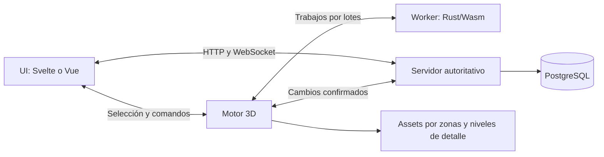

# Frontend para una mesa 3D con Rust y WebAssembly

Fecha: 15 de octubre de 2026. Investigación de documentación primaria. Este documento reemplaza la recomendación inicial de React como elección por defecto; no cambia todavía las dependencias ni declara una integración probada.

## Recomendación

Si mantenemos un backend Rust y una mesa de comportamiento local: **Svelte 5 + TypeScript + Vite**, un módulo de escena independiente y módulos Rust/Wasm para tareas concretas. **Vue 3** es una alternativa igualmente viable para esta estructura. Esta preferencia es una evaluación de encaje y simplicidad; no un resultado de benchmark ni una afirmación de que Svelte dibuje más rápido que otros frameworks.

Si se prefiere Elixir para el servidor, **Phoenix LiveView + PlayCanvas + Rust/Wasm** es otra arquitectura coherente. No necesita un backend Rust adicional. LiveView llevaría fichas, campañas y conocimiento; el motor y el cálculo Wasm seguirían ejecutándose en el navegador.

La elección de motor permanece separada: PlayCanvas es un candidato fuerte por su conjunto de funcionalidades para escenas y su flujo de splats/LOD. Babylon.js debe compararse para mapas basados en mallas y efectos; Three.js + Spark debe compararse si los escenarios generados se entregan mayoritariamente como splats. Ningún motor tiene rendimiento demostrado para nuestras escenas todavía.

## Necesidades que guían la decisión

- App privada en español, con sesiones largas y UI de fichas, diario, inventario, conjuros y conocimiento enlazado.
- Prioridad de diseño y facilidad de uso; la UI debe responder mientras se mueve la cámara.
- Escenarios caminables interpretados desde ilustraciones o mapas de fantasía, no exclusivamente capturas fotográficas de lugares reales.
- Cámara, animación y previsualización local, con estado de partida validado por servidor.
- Rust/Wasm interoperable mediante una frontera pequeña; no incluir Python ni un segundo servidor de UI sin una necesidad concreta.
- Múltiples campañas aisladas y conservación de edición/fuente/licencia del contenido.
- Compatibilidad de navegador, memoria y tiempo por frame medidos sobre assets representativos.

## Comparación de UI

Las etiquetas siguientes son evaluación para este proyecto, no posiciones universales de calidad. Todos los frameworks de navegador pueden integrarse con Wasm mediante JavaScript; Wasm no exige React.

| Opción | Encaje en el stack | Integración y principal compromiso |
|---|---|---|
| Svelte 5 | Primera opción con servidor Rust | Componentes compilados, reactividad granular, TypeScript y animación integrados. Montar el motor en el ciclo de vida y destruirlo al salir. No introducir entidades del motor en estado reactivo profundo |
| Vue 3 | Finalista con servidor Rust | Componentes, formularios y reactividad. `shallowRef` y `markRaw` permiten conservar instancias externas sin convertirlas en proxies. Mantener escena y UI separadas |
| Solid | Candidato técnicamente sólido | Signals y actualizaciones finas. El montaje/limpieza encaja con un motor imperativo. Validar que las bibliotecas de componentes concretas cubran la UI requerida; no inferir FPS del modelo reactivo |
| React | Viable, no obligatorio | Tiene integración oficial `@playcanvas/react`. Puede usar también un canvas imperativo. Su ventaja específica aquí es esa integración; no una afinidad especial con Rust |
| Phoenix LiveView | Finalista si el servidor será Elixir | Hooks, eventos y DOM ignorado permiten alojar el motor. Interacciones continuas permanecen locales. Con Rust obligatorio como servidor añade otro runtime que coordinar |
| Leptos | Candidato si se prioriza UI escrita en Rust | Signals, DOM y SSR/CSR; documenta wasm-bindgen y web-sys. PlayCanvas sigue siendo JS: la interfaz entre runtimes necesita diseño y mantenimiento |
| Dioxus | Candidato si también interesa escritorio/móvil | UI Rust con soporte web/Wasm y backend Axum. Verificar características contra una versión publicada: el README de main puede incluir trabajo en desarrollo. Interop con el motor JS pendiente de prueba |
| Lit / Web Components | Útil como frontera del motor | Ciclo de vida estándar y componente reutilizable. Para toda la app habría que elegir además routing, datos y componentes; para envolver el canvas reduce dependencia del framework |
| Angular | Viable si se prefiere una estructura más amplia | Documenta modo zoneless y notificación explícita de cambios. El motor puede permanecer fuera del ciclo de UI. No aporta aquí una ventaja específica que compense por sí sola un cambio de ecosistema |
| Astro | Mejor candidato para un portal editorial separado | HTML y pequeñas islas interactivas. Puede alojar una mesa, pero si casi toda la sesión vive en una isla con estado compartido, el beneficio principal de Astro pesa menos |
| Qwik | Menor prioridad para esta app | Resumability y carga diferida atienden especialmente la entrada a una página SSR. La instancia viva de un motor 3D necesita inicialización cliente; la resumability no elimina su trabajo por frame |

### Fuentes de UI

- [Svelte: concepto y compilación](https://svelte.dev/docs/svelte/overview), [ciclo de vida](https://svelte.dev/docs/svelte/lifecycle-hooks). El callback de `onMount` puede devolver limpieza; si se declara async, devuelve una Promise y esa limpieza requiere otra estructura.
- [Vue: APIs avanzadas de reactividad](https://vuejs.org/api/reactivity-advanced.html). Sus APIs superficiales y valores raw exigen cuidar identidad y objetos anidados.
- [Solid: reactividad](https://docs.solidjs.com/concepts/intro-to-reactivity), [limpieza](https://docs.solidjs.com/reference/lifecycle/on-cleanup).
- [PlayCanvas React](https://developer.playcanvas.com/user-manual/react/). Es una integración soportada, no un requisito para usar el motor.
- [LiveView: hooks y eventos](https://phoenix-live-view.hexdocs.pm/js-interop.html), [Phoenix Channels](https://phoenix.hexdocs.pm/channels.html).
- [Leptos: integración JavaScript](https://book.leptos.dev/web_sys.html).
- [Dioxus: repositorio oficial](https://github.com/DioxusLabs/dioxus). No se han validado benchmarks, tamaño de producción ni compatibilidad de una combinación concreta de versiones.
- [Lit: ciclo de vida](https://lit.dev/docs/components/lifecycle/), [PlayCanvas Web Components](https://developer.playcanvas.com/user-manual/web-components/).
- [Angular zoneless](https://angular.dev/guide/zoneless).
- [Astro: islas](https://docs.astro.build/en/concepts/islands/), [Qwik: resumability](https://qwik.dev/docs/concepts/resumable/).
- Para componentes accesibles con estética propia en Svelte: [Bits UI](https://www.bits-ui.com/docs/introduction) ofrece primitivas sin imponer diseño, navegación por teclado y gestión de foco. Esto no sustituye nuestra verificación de accesibilidad.

## Qué significa integrar Rust/Wasm

PlayCanvas no requiere que la UI esté escrita en Rust ni que el backend use el mismo lenguaje. La escena y la UI viven en el navegador; el backend es otro proceso. Las siguientes fronteras deberían permanecer explícitas:

- El motor mantiene sus entidades, cámara y loop de animación fuera del estado reactivo de UI.
- La UI recibe solo el estado necesario: selección, nombre, PG, estados, resultado de búsqueda y mensajes de error.
- Wasm recibe trabajos por lotes; evitar una llamada JS↔Wasm por entidad y por frame sin medirla.
- La API Wasm debe definir unidades, ejes, IDs, límites de buffers y propiedad de memoria. Una vista TypedArray puede quedar inválida si crece la memoria Wasm.
- Los jobs asíncronos llevan ID de escena, revisión y job ID para descartar resultados obsoletos al cambiar de mapa.
- El servidor ordena comandos y valida permisos. No se presupone física determinista entre arquitecturas ni lockstep perfecto por compartir Rust.
- Al reconectar se obtiene snapshot y revisión; las previsualizaciones locales no se convierten por sí solas en estado confirmado.
- El cleanup libera motor, callbacks, workers, object URLs y recursos GPU según su propietario.

Estas son decisiones de arquitectura propuestas, no funcionalidades implementadas. Para workers y puente JS: [ejemplo oficial wasm-bindgen](https://wasm-bindgen.github.io/wasm-bindgen/examples/wasm-in-web-worker.html).

## Dónde LiveView puede encajar bien

LiveView tiene un límite bien definido: no debe recibir cada actualización de cámara o cada frame de desplazamiento. Su hook monta la escena en un contenedor con gestión de DOM apropiada; `pushEvent`/`handleEvent` o Channels intercambian acciones discretas y cambios de estado. Su API también tiene callbacks de desconexión y reconexión.

La UI puede usar comandos JS locales para abrir paneles o animar sin viaje al servidor. Buscar contenido, guardar fichas y confirmar acciones sí puede necesitar red. Eso debe probarse con latencia simulada y una conexión interrumpida. LiveView no aporta automáticamente edición offline.

Si elegimos Phoenix como servidor, simplificaría alrededor de Ecto/PostgreSQL y PubSub/Channels. Rust/Wasm seguiría siendo un módulo del navegador; no introduciría Axum además de Phoenix solo para conservar el nombre Rust en el backend. Un cálculo CPU pesado servidor podría añadirse después como proceso independiente o integración cuidadosamente evaluada.

## Comparación de motor para el requisito nuevo

| Motor | Ventaja comprobada | Qué falta probar |
|---|---|---|
| PlayCanvas | Motor web, entidades, assets y render; flujo documentado de splats con streaming por regiones y presupuesto global. En WebGPU dispone de sorting GPU; WebGL puede usar sorting en worker | Importación de nuestros modelos, geometría de colisión, efecto de miniaturas y VFX, pérdidas de dispositivo y controles accesibles |
| Babylon.js | Motor completo; thin instances, herramientas, materiales y soporte documentado de varios formatos de splats | Rendimiento y flujo de edición/streaming con los mismos assets. No equiparar lectura de formato con funcionalidad idéntica |
| Three.js + Spark | Spark aporta renderer de splats con LOD y código Rust/Wasm documentado; puede coexistir con mallas en Three | Necesitamos completar navegación, colisiones, entidades y herramientas de juego. Verificar renderer/API GPU concretos, sin asumir WebGPU por el nombre del producto |
| Rust + Bevy/wgpu | Motor Rust multiplataforma y núcleo ECS; ya evaluado en tecnologias-3d.md | Coste de integración con UI HTML y pipeline de escenarios generados. No se añade a la vez que PlayCanvas para renderizar el mismo mundo |

Fuentes: [PlayCanvas LOD/streaming](https://developer.playcanvas.com/user-manual/gaussian-splatting/building/lod-streaming/), [renderers](https://developer.playcanvas.com/user-manual/gaussian-splatting/rendering-architecture/renderers/), [colisiones en SuperSplat](https://developer.playcanvas.com/user-manual/supersplat/studio/collision/), [Babylon splats](https://doc.babylonjs.com/features/featuresDeepDive/mesh/gaussianSplatting/), [Spark](https://sparkjs.dev/docs/), [Spark LOD y Wasm](https://sparkjs.dev/docs/new-spark-renderer/).

El generador de colisiones de SuperSplat Studio es una herramienta de preparación de assets; no se presenta como un servicio incluido automáticamente al usar el Engine de PlayCanvas en nuestra app.

## Decisión provisional y criterios de cierre

1. UI: Svelte 5 como recomendación para el stack Rust existente; Vue 3 como alternativa directa. Solid se mantiene viable, sin elegirlo por un benchmark genérico de DOM.
2. Motor: PlayCanvas como candidato principal por encaje funcional; Babylon y Spark se comparan usando assets de verdad según el formato final de los mundos.
3. Rust/Wasm: módulos puntuales que justifiquen su frontera, sin transportar la escena entera al framework de UI.
4. Backend: Rust si esa preferencia se mantiene; Phoenix si se elige LiveView. No desplegar ambos por defecto.
5. Python: queda fuera de la partida; solo se incluiría en un job de generación que realmente lo necesite.

Prueba necesaria: mismo escenario caminable y mismos assets, con cámara, selección, ficha abierta, búsqueda y mensajes de estado concurrentes. Comparar p95 del frame, latencia de interacción, memoria cuando sea medible, descarga inicial y cleanup tras varias entradas/salidas. Medir UI y motor por separado. Comparar primero Svelte/Vue solo si hay incertidumbre funcional; no duplicar toda la app para perseguir diferencias irrelevantes al cuello de botella.

Los documentos de investigación anteriores y el package.json inicial contienen propuestas históricas. Este archivo explica la recomendación actual; no se afirma que el prototipo original esté terminado o que se haya migrado ya a Svelte.
